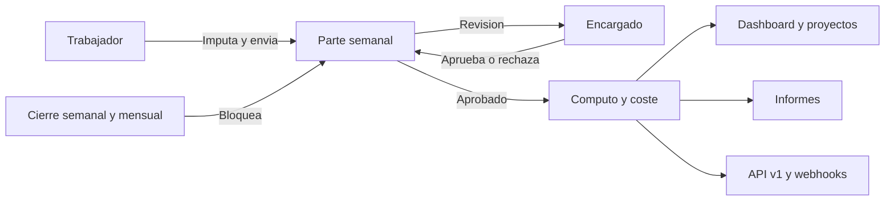

<div align="center">
  

  # LeviParte

  **Parte semanal de horas con imputación a proyecto para Levitec.**

  [](https://github.com/marianorluna/parte-semanal/actions/workflows/ci.yml)
  [](LICENSE)

  Next.js 16 · React 19 · TypeScript estricto · PostgreSQL 16 · Drizzle ORM
</div>

---

## Qué es

LeviParte sustituye la hoja de cálculo semanal de horas. Cada trabajador declara minutos por día, proyecto y tarea; su encargado revisa y aprueba la semana. Sobre ese registro, la aplicación calcula horas por proyecto, cumplimiento, cómputo por convenio, coste, presupuesto, cierres, informes y avisos.

Está en producción en **[horas.levitec.marianorluna.com](https://horas.levitec.marianorluna.com)** para una constructora con unos 20 proyectos activos y hasta 1.000 trabajadores previstos.

| Necesidad | Respuesta de LeviParte |
|-----------|------------------------|
| Declarar horas sin fricción | Rejilla semanal con autoguardado, modo rápido y copia de la semana anterior |
| Revisar sin revisar una por una | Bandeja filtrable, aprobación en lote y vista de equipo |
| Que las horas cuadren | Jornada teórica por calendario, convenio y ausencias; desviación firmada |
| Saber cuánto cuesta cada obra | Tarifas versionadas, presupuesto por versiones y semáforo de riesgo |
| Cerrar el mes sin sorpresas | Cierre semanal y mensual con reapertura auditada |
| Integrar con otros sistemas | API v1 con claves, idempotencia y webhooks firmados |
| No perder tiempo en lo administrativo | Informes en segundo plano, avisos por correo y briefing con IA |

## Qué incluye

- **Trabajador:** rejilla semanal, modo rápido y detalle, presets, copia de la semana anterior, deshacer, ajuste de un día, envío con justificación de desviación y vista imprimible o PDF.
- **Revisión:** bandeja por estado y proyecto, detalle con cómputo y coste, aprobación, rechazo con motivo y reapertura auditada.
- **Control:** dashboard con KPIs, tendencia de ocho semanas, horas por proyecto, semáforo de riesgo y briefing con IA.
- **Administración:** usuarios, empleados, proyectos, tareas, asignaciones, calendarios, festivos, convenios, reglas de cómputo, tarifas, presupuestos, tipos de ausencia, cierres, informes, claves de API, webhooks, correos y auditoría.
- **Calendario y ausencias:** laborables, festivos de cinco ámbitos, excepciones, jornada teórica versionada, vacaciones y permisos con saldo.
- **Cómputo y coste:** minutos equivalentes por regla de convenio, tarifa de empleado o categoría, líneas de coste por imputación.
- **Proyecto de ajuste:** proyecto interno único que absorbe horas no imputables sin ensuciar el semáforo de riesgo.
- **Informes:** CSV, XLSX y PDF bajo demanda, generados en `pg-boss`, con enlace firmado y caducidad.
- **Integración:** API REST v1, `Idempotency-Key`, límite de 60 peticiones por minuto, OpenAPI 3.0 y webhooks con HMAC y reintentos.
- **Asistente de IA:** briefing semanal y borrador de motivo de rechazo, de solo lectura, con pseudonimización y auditoría de tokens.

## Cómo funciona en 60 segundos

1. **Imputa.** El trabajador abre `/mi-semana` y declara minutos por día, proyecto y tarea sobre una rejilla con autoguardado, festivos, ausencias y aviso de exceso.
2. **Envía.** El parte pasa a `ENVIADO`. Si la semana ya terminó y no cuadra con la jornada teórica, deja un motivo firmado de 10 a 500 caracteres.
3. **Revisa.** El encargado aprueba, rechaza con motivo o reabre desde `/control/partes`. Al aprobar se guardan cómputo por convenio y coste por imputación.
4. **Explota y cierra.** Dashboard, proyectos, informes, API y webhooks consumen el dato. El cierre semanal o mensual bloquea lo aprobado y solo se revierte con una reapertura auditada.

El recorrido completo, con roles, permisos, estados, casos límite y pantalla a pantalla, está en [`docs/product.md`](docs/product.md).

## Roles

| Rol | Qué hace |
|-----|----------|
| `TRABAJADOR` | Imputa y envía sus horas, gestiona sus ausencias y consulta sus avisos |
| `ENCARGADO` | Revisa partes de trabajadores de sus proyectos, ve equipo y dashboard, no revisa a otros encargados ni sus propias horas |
| `ADMIN` | Administra usuarios, proyectos, calendario, convenios, costes, cierres, informes, API y auditoría; revisa cualquier parte |
| Integración API | Lee partes y proyectos y escribe imputaciones con alcances acotados; no aprueba ni administra |

Matriz completa de permisos en [`docs/product.md`](docs/product.md#4-matriz-de-permisos).

## Cómo se organiza



El dominio no conoce HTTP ni PostgreSQL: los casos de uso dependen de puertos y `src/composition.ts` inyecta los adaptadores. Toda la lógica de negocio vive en `src/modules`; la interfaz, en `src/app`.

## Arranque rápido

Requisitos: Node 22 o superior, Docker y npm.

```bash
git clone https://github.com/marianorluna/parte-semanal.git
cd parte-semanal
cp .env.example .env
docker compose up -d db
npm install
npm run db:migrate
npm run db:seed:demo   # opcional: 50 usuarios de demostracion
npm run dev
```

Abre `http://localhost:3000`. Con `ACCESO_RAPIDO_DEMO=true` el login muestra un botón por rol.

| Comando | Qué hace |
|---------|----------|
| `npm run dev` | Servidor de desarrollo |
| `npm run build` / `npm start` | Build y arranque de producción |
| `npm run lint` / `npm run typecheck` / `npm test` | Calidad |
| `npm run db:generate` | Genera migración desde el esquema |
| `npm run db:migrate` | Aplica migraciones |
| `npm run db:studio` | Explorador de datos |
| `npm run db:seed:demo` | Carga el demo idempotente |
| `npm run db:seed:demo:purge` | Purga el demo en una transacción |

Guía detallada, variables de entorno y solución de problemas en [`docs/onboarding.md`](docs/onboarding.md).

## Despliegue e integración

Un único recurso Docker Compose en Coolify levanta la app y PostgreSQL 16; las migraciones se aplican en el entrypoint y el healthcheck decide si entra tráfico. Topología, variables, backups y runbook en [`docs/operations.md`](docs/operations.md).

La API v1 expone partes, proyectos e imputaciones con clave Bearer, idempotencia y webhooks firmados. Contrato completo en [`docs/api.md`](docs/api.md) y OpenAPI en `/api/v1/openapi.json`.

## Documentación

| Documento | Contenido |
|-----------|-----------|
| [`docs/product.md`](docs/product.md) | Funcional: roles, permisos, flujo del dato, estados, reglas de calendario, desviación, cómputo, coste, cierres, IA y pantallas |
| [`docs/architecture.md`](docs/architecture.md) | Técnico: capas, módulos, modelo de datos, flujos, concurrencia y decisiones de diseño |
| [`docs/api.md`](docs/api.md) | API v1, autenticación, idempotencia, errores, OpenAPI y webhooks |
| [`docs/operations.md`](docs/operations.md) | Despliegue en Coolify, backups, colas, cron, salud y runbook |
| [`docs/onboarding.md`](docs/onboarding.md) | Entorno local, demo y primeros pasos |
| [`docs/decisions.md`](docs/decisions.md) | ADR con los porqués ya decididos |
| [`AGENTS.md`](AGENTS.md) | Stack, dominio y estado de sesión |

## Stack

| Capa | Elección | Motivo |
|------|----------|--------|
| Interfaz | Next.js 16 App Router, React 19, Tailwind CSS 4 | Server Components por defecto y estado de cliente mínimo |
| Lenguaje | TypeScript estricto | `strict` y `noUncheckedIndexedAccess`, sin `any` |
| Datos | PostgreSQL 16, Drizzle ORM, `drizzle-kit` | SQL tipado y migraciones versionadas en el repo |
| Validación | Zod 4 | Una frontera, un esquema |
| Sesión | Auth.js 5 Credentials, argon2id, JWT | Cookie httpOnly y refresco del usuario en cada petición |
| Cola | `pg-boss` | Sin Redis ni servicio extra; misma base de datos |
| Documentos | `exceljs`, `@react-pdf/renderer` | XLSX y PDF en servidor |
| Correo | Nodemailer | Salida opcional por SMTP |
| Tests | Vitest | Dominio y casos de uso |

Decisiones y alternativas descartadas en [`docs/decisions.md`](docs/decisions.md).

## Calidad

`npm run lint`, `npm run typecheck` y `npm test` deben pasar antes de abrir un pull request. La CI de GitHub Actions ejecuta además el build y aplica las migraciones sobre un PostgreSQL 16 efímero.

Convenciones de commit, estilo y ámbito de cambios en [`.cursor/rules/`](.cursor/rules/).

## Estado del proyecto

Fase 1 (MVP) y fase 2 completas: calendario, cómputo, ausencias, coste, presupuesto, informes, cierres, correo, API y webhooks. En validación sobre staging y pendiente de un smoke test completo en producción y de una restauración de backup verificada.

Limitaciones conocidas y hoja de ruta en [`AGENTS.md`](AGENTS.md) y [`docs/decisions.md`](docs/decisions.md).

## Seguridad

- Contraseñas con argon2id; nunca se registran en claro.
- Sesión en cookie httpOnly, `SameSite=Lax` y `Secure` en producción.
- Consultas parametrizadas mediante Drizzle; sin SQL concatenado.
- Autorización por rol y por ámbito de proyecto en cada caso de uso, no solo en la interfaz.
- Cabeceras de seguridad, errores sin trazas y claves de API con hash HMAC.
- Secretos solo en el entorno del servidor; `.env` fuera del repositorio.

Para reportar una vulnerabilidad, contacta con el equipo de Levitec antes de abrir un issue público.

## Licencia

MIT. Consulta [`LICENSE`](LICENSE).

---

<div align="center">
  <sub>Levitec · Parte semanal de horas</sub>
</div>
