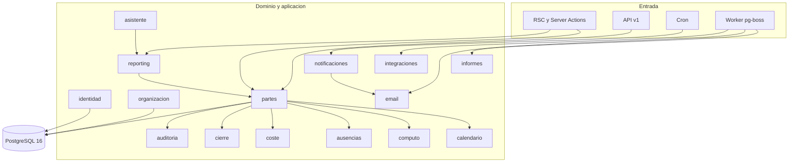
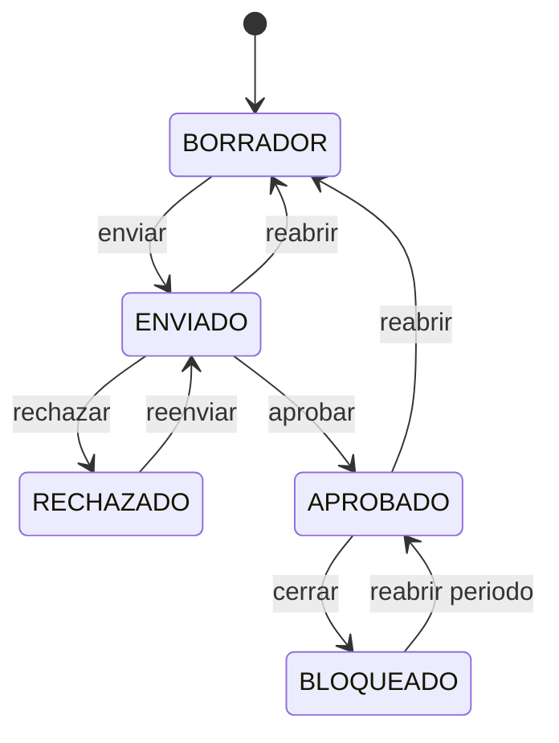
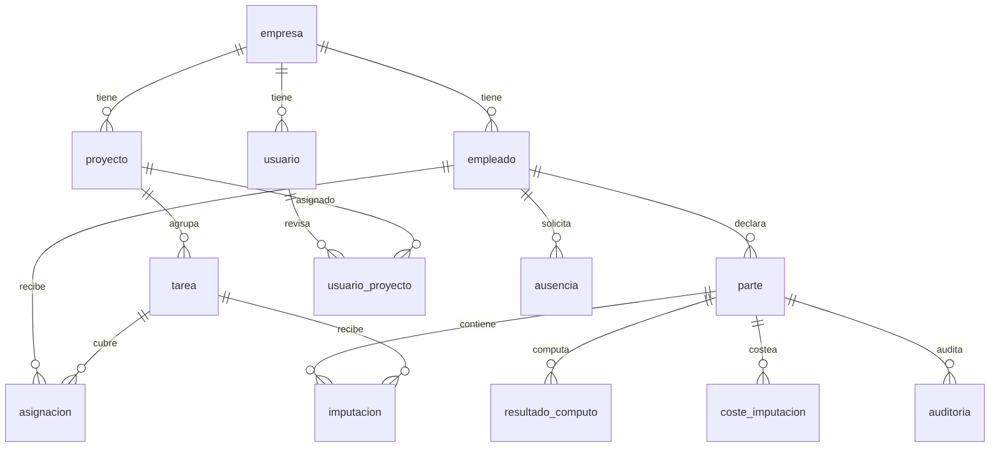
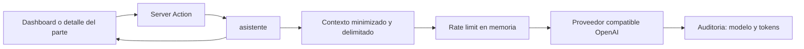

# Arquitectura

Mapa técnico de LeviParte. El estilo de código y las prohibiciones están en `.cursor/rules/`; el comportamiento funcional, en [`product.md`](./product.md).

- **Stack:** [`AGENTS.md` §2](../AGENTS.md#2-stack-del-proyecto)
- **Producto y dominio:** [`AGENTS.md` §3](../AGENTS.md#3-contexto-de-negocio)

## 1. Principios

- **Monolito modular con puertos y adaptadores.** Un solo despliegue (contenedor Next.js) y una sola base de datos. Los módulos tienen límites explícitos y pueden extraerse si el volumen lo exige ([ADR-001](./decisions.md#adr-001---monolito-modular-con-un-solo-despliegue)).
- **El dominio no conoce la infraestructura.** No importa Next.js, Drizzle, HTTP ni `process.env`.
- **Regla de dependencia:** `app → application → domain`; `infrastructure` implementa los puertos que declara `application`. El dominio no importa de `app/`, `db/` ni `next/*`.
- **Límite entre módulos:** no hay `index.ts` por módulo. Un módulo consume de otro sus tipos y casos de uso de `application` (por ejemplo `UsuarioSesion` de `identidad`) y, cuando necesita datos, los recibe como dependencia inyectada desde `src/composition.ts` o usa una consulta de lectura de `infrastructure`. No se importan tablas ajenas para escribir; el acceso a datos de otro módulo pasa por su puerto o por su consulta de lectura. La raíz de composición es el único punto que conoce todos los adaptadores.
- **La verdad se calcula en el servidor.** Totales, capacidad, desviación, cómputo, coste y permisos se resuelven en servidor; el cliente solo presenta y captura.
- **La interfaz no es la defensa.** Cada caso de uso vuelve a comprobar rol, alcance y estado.
- **Sin estado global compartido.** La sesión vive en cookie; el estado de UI es local al componente.

## 2. Estructura de carpetas

```text
parte-diario/
├── src/
│   ├── app/
│   │   ├── (app)/                        # shell autenticado
│   │   │   ├── mi-semana/                # rejilla y acciones del trabajador
│   │   │   ├── mis-ausencias/
│   │   │   ├── notificaciones/
│   │   │   ├── partes/[id]/imprimir|pdf
│   │   │   ├── control/                  # bandeja, equipo, dashboard, proyectos, ausencias
│   │   │   └── admin/                    # usuarios, proyectos, calendario, convenios,
│   │   │                                 # costes, informes, cierres, ausencias, emails,
│   │   │                                 # api, auditoria, demo
│   │   ├── api/
│   │   │   ├── auth/[...nextauth]/
│   │   │   ├── health/                   # sonda de Coolify
│   │   │   └── v1/                       # partes, proyectos, imputaciones, openapi, cron
│   │   ├── login/
│   │   ├── sin-acceso/
│   │   ├── globals.css                   # tokens de marca y utilidades
│   │   └── layout.tsx
│   ├── components/                       # UI compartida: badges, menús, gráficos, IA
│   ├── config/
│   │   ├── env.ts                        # validación Zod del entorno
│   │   ├── marca.ts                      # identidad visible
│   │   └── enlaces.ts
│   ├── db/
│   │   ├── schema.ts                     # 36 tablas Drizzle
│   │   ├── client.ts                     # pool de postgres
│   │   ├── migrations/                   # 0000 a 0011 y meta
│   │   └── seed/                         # demo idempotente y purga
│   ├── jobs/
│   │   ├── cola.ts                       # encolado de informes, correos y webhooks
│   │   └── worker.ts                     # worker pg-boss, una vez por proceso
│   ├── modules/                          # 15 módulos de negocio
│   │   └── <modulo>/{domain,application,infrastructure,index.ts}
│   ├── shared/errors.ts                  # AppError y mapeo a HTTP
│   ├── auth.ts                           # configuración de Auth.js
│   ├── composition.ts                    # raíz de composición
│   └── instrumentation.ts                # arranque del worker
├── docker/entrypoint.mjs                 # migraciones antes de arrancar
├── Dockerfile                            # multi-stage, salida standalone
├── compose.yml                           # app + Postgres para Coolify
├── compose.override.yml                  # publica el puerto de Postgres en local
├── scripts/migrate.mjs
├── docs/
└── AGENTS.md
```

No se crean carpetas vacías: cada módulo nace con su primer caso de uso real.

## 3. Módulos



| Módulo | Responsabilidad | No hace |
|--------|-----------------|---------|
| `identidad` | Usuario, rol, sesión, hash argon2id, políticas de alcance propio, por proyecto y global | Reglas de partes |
| `organizacion` | Empresa, empleado, proyecto, tarea y asignación | Registrar horas |
| `partes` | Parte semanal, imputaciones, totales, máquina de estados, desviación y copia de semana anterior | Consultas de dashboard |
| `calendario` | Laborables, festivos, excepciones, jornada teórica versionada y precarga de festivos | Aprobar partes |
| `computo` | Convenios, reglas versionadas y resultado por imputación y tramo | Decidir estados |
| `ausencias` | Tipos, solicitudes, saldos, capacidad reducida y bloqueo de días | Sincronizar con RRHH |
| `coste` | Tarifas, presupuesto versionado, coste por imputación y ejecución | Calcular nómina |
| `cierre` | Periodos cerrados, bloqueo y reapertura | Recalcular cómputo |
| `reporting` | Agregados, bandejas, dashboard, exportadores CSV, XLSX y PDF | Escribir datos de negocio |
| `informes` | Solicitud, generación asíncrona y descarga firmada | Servir ficheros sin token |
| `email` | Preferencias, plantillas, envío SMTP y estado de entrega | Decidir cuándo avisar |
| `notificaciones` | Generación idempotente de avisos y bandeja in-app | Entregar correo |
| `integraciones` | Claves de API, rate limit, idempotencia, webhooks y outbox | Reglas de partes |
| `auditoria` | Registro append-only de cambios, accesos e IA | Decidir permisos |
| `asistente` | Briefing y borrador de motivo sobre datos ya calculados | Escribir, aprobar, rechazar o calcular |

## 4. Capas

| Capa | Contenido | Reglas |
|------|-----------|--------|
| `domain` | Entidades, tipos y funciones puras (`validarParte`, `evaluarDesviacion`, `calcularLinea`, `riesgoProyecto`, `construirContextoBriefing`) | Sin I/O, sin ORM, sin hora implícita: recibe fecha y datos por parámetro |
| `application` | Casos de uso, puertos, transacciones y orquestación | No valida HTTP ni formatea respuestas |
| `infrastructure` | Repositorios Drizzle, mapeadores, SMTP, proveedor de IA, exportadores | Sin reglas de negocio |
| `app` | RSC, Server Actions y route handlers | Valida con Zod, autoriza, invoca el caso de uso y mapea errores |

### Raíz de composición

`src/composition.ts` es el único lugar que conoce implementaciones. Construye objetos de dependencias (`DepsPartes`, `DepsComputo`, `DepsCoste`, `DepsCierre`, `DepsInformes`, `DepsIntegraciones`, `DepsAvisos`, `DepsAsistente`) y los expone a las páginas y acciones. Un test puede sustituir un repositorio sin tocar el caso de uso; un cambio de proveedor de IA o de SMTP solo toca la infraestructura.

## 5. Flujos

### 5.1 Lectura (RSC)

1. La página llama a `requireUsuario()` o `requireRol()`.
2. Resuelve dependencias desde `composition.ts`.
3. Invoca un caso de uso de consulta, que aplica el alcance.
4. El repositorio devuelve filas planas y la capa de aplicación las convierte en DTO de presentación.
5. El componente renderiza en servidor. No hay `useEffect` para datos iniciales.

### 5.2 Escritura (Server Action)

1. Formulario cliente o acción de botón.
2. Zod valida la entrada.
3. `autorizar()` comprueba sesión y rol; el caso de uso comprueba alcance y estado.
4. El caso de uso abre transacción, escribe el cambio y registra auditoría y outbox en la misma transacción.
5. Devuelve un resultado tipado; la acción lo mapea a `{ success, data | error }`.
6. `revalidatePath` refresca la vista.

La acción nunca lanza errores de negocio al cliente: los convierte en `AppError` con código público.

### 5.3 API v1

1. El route handler valida el `Bearer` contra `api_key` (HMAC con `AUTH_SECRET`) y comprueba alcance, caducidad y estado.
2. Aplica rate limit por clave y minuto.
3. En escritura, reclama `Idempotency-Key` en `api_idempotencia` antes de procesar.
4. Invoca el mismo caso de uso que la interfaz, con un actor de origen API.
5. Serializa la respuesta y, si procede, guarda el cuerpo para una repetición idempotente.

Detalle de contratos en [`api.md`](./api.md).

### 5.4 Cron

`GET|POST /api/v1/cron/avisos` exige `CRON_SECRET` y comprueba la ventana (`viernes`, `lunes`, `manual`). Genera avisos con clave de idempotencia, encola correos y devuelve un resumen. Los endpoints de webhooks y salud siguen el mismo patrón de secreto compartido.

### 5.5 Jobs

`instrumentation.ts` arranca `src/jobs/worker.ts` una sola vez por proceso, protegido contra el hot reload y desactivable con `INFORMES_WORKER=off`. El worker registra las colas de informes, correos y webhooks y ejecuta la limpieza de informes caducados. Los jobs son idempotentes y guardan su estado en base de datos ([ADR-016](./decisions.md#adr-016---worker-de-pg-boss-en-el-mismo-contenedor)).

### 5.6 Estados y efectos de escritura



| Escritura | Transición | Efectos en la misma transacción |
|-----------|------------|---------------------------------|
| Crear parte | Ninguna | Alta de `parte` en `BORRADOR` |
| Guardar semana | Ninguna | Upsert de `imputacion`, recálculo de `total_minutos`, incremento de `version` |
| Enviar semana | `BORRADOR` o `RECHAZADO` a `ENVIADO` | Snapshot de calendario, `capacidad_min`, `desviacion_min` y `motivo_desviacion`; auditoría; evento en `outbox` |
| Aprobar | `ENVIADO` a `APROBADO` | Snapshot de `resultado_computo` y `coste_imputacion`; auditoría; evento en `outbox` |
| Rechazar | `ENVIADO` a `RECHAZADO` | `motivo_rechazo`; limpieza de desviación; auditoría; evento en `outbox` |
| Reabrir parte | `ENVIADO` o `APROBADO` a `BORRADOR` | Limpieza de desviación, cómputo y coste; auditoría; evento en `outbox` |
| Cerrar periodo | `APROBADO` a `BLOQUEADO` | Alta en `periodo_cerrado`; auditoría |
| Reabrir periodo | `BLOQUEADO` a `APROBADO` | Baja lógica del cierre; recálculo de cómputo y coste; auditoría |

El detalle funcional de cada transición, con requisitos y quién puede ejecutarla, está en [`product.md`](./product.md#6-ciclo-de-vida-del-parte).

## 6. Autenticación y autorización

- **Proveedor:** Auth.js 5 con Credentials. `authorize` busca el usuario por email en minúsculas, comprueba `activo` y verifica argon2id.
- **Sesión:** JWT de 8 horas en cookie httpOnly, `SameSite=Lax` y `Secure` en producción. El token lleva `rol`, `empleadoId` y `empresaId` para pintar la navegación.
- **Refresco:** `usuarioActual()` relee el usuario de base de datos en cada petición y lo memoiza con `cache` de React. Un usuario dado de baja o cambiado de rol pierde el acceso aunque su JWT siga vigente.
- **Autorización de página:** `requireUsuario()` redirige a `/login`; `requireRol()` redirige a `/sin-acceso`.
- **Autorización de acción:** `autorizar()` lanza `NO_AUTENTICADO` o `SIN_PERMISO`. El alcance por proyecto y la revisión de iguales se resuelven en los casos de uso.
- **Alcance del encargado:** `proyectosPermitidos()` devuelve los proyectos de `usuario_proyecto`; las consultas de bandeja, detalle y dashboard filtran por esa lista. Un parte sin ningún proyecto del encargado no aparece y su detalle responde `NO_ENCONTRADO`.
- **Auditoría de sesión:** `signIn` y `signOut` registran `LOGIN` y `LOGOUT`.

## 7. Modelo de datos

36 tablas en PostgreSQL 16, definidas en `src/db/schema.ts` y versionadas en `src/db/migrations/` (`0000` a `0011`).

### 7.1 Relaciones principales



### 7.2 Tablas por ámbito

| Ámbito | Tablas |
|--------|--------|
| Identidad y organización | `empresa`, `empleado`, `proyecto`, `tarea`, `usuario`, `usuario_proyecto`, `asignacion` |
| Calendario y convenio | `calendario`, `festivo`, `excepcion_calendario`, `empleado_calendario`, `jornada_teorica`, `convenio`, `regla_computo`, `empleado_convenio` |
| Ausencias | `tipo_ausencia`, `ausencia`, `saldo_vacaciones` |
| Partes | `parte`, `imputacion` |
| Cómputo y coste | `resultado_computo`, `coste_hora`, `presupuesto_proyecto`, `coste_imputacion` |
| Cierres e informes | `periodo_cerrado`, `informe` |
| Notificaciones | `notificacion`, `preferencia_aviso`, `email_envio` |
| Integraciones | `api_key`, `api_rate_limit`, `api_idempotencia`, `webhook`, `webhook_entrega`, `outbox` |
| Auditoría | `auditoria` |

### 7.3 Invariantes

- `imputacion.minutos` es entero y cumple `0 < minutos <= 1440`.
- `UNIQUE(parte_id, fecha, tarea_id)` en imputación; `UNIQUE(empleado_id, iso_year, iso_week)` en parte.
- `parte.estado` pertenece a `BORRADOR`, `ENVIADO`, `APROBADO`, `RECHAZADO` o `BLOQUEADO`.
- `parte.version` es la columna de concurrencia optimista.
- La migración `0011` añade la desviación firmada: `parte.capacidad_min`, `parte.desviacion_min` y `parte.motivo_desviacion`, con el check `parte_desviacion_ck` que exige capacidad no negativa y que un motivo solo exista si hay capacidad declarada.
- `proyecto.es_ajuste` se protege con el índice único parcial `proyecto_ajuste_empresa_uq`: como máximo un proyecto de ajuste por empresa.
- `periodo_cerrado` no admite dos cierres activos solapados del mismo tipo y ámbito.
- `auditoria` es append-only: sin `UPDATE` ni `DELETE` desde la aplicación.
- Importes en céntimos y minutos en enteros; ninguna operación de negocio usa coma flotante.
- Fechas de negocio como `date` sin zona; marcas temporales como `timestamptz`. El contenedor y PostgreSQL usan `TZ=Europe/Madrid`.

### 7.4 Índices relevantes

- `parte(estado, iso_year, iso_week)` para la bandeja.
- `parte(empleado_id, iso_year, iso_week)` único.
- `imputacion(parte_id)` y `imputacion(tarea_id, fecha)` para detalle y agregados.
- Índice único parcial de proyecto de ajuste.
- Índices únicos de idempotencia de avisos, correos y API.

## 8. Concurrencia y transacciones

- **Bloqueo optimista:** el cliente envía la `version` que leyó. El repositorio hace `UPDATE ... WHERE id = ? AND version = ?`. Si no afecta a ninguna fila, devuelve `CONFLICTO_VERSION` y la UI pide recargar. Nunca se sobrescribe una edición ajena.
- **Una escritura, una transacción:** guardar la semana, enviar, aprobar, rechazar, reabrir y cerrar escriben el cambio de estado, la auditoría y el evento de outbox en la misma transacción.
- **Idempotencia del cron:** cada aviso y cada correo llevan una clave única por usuario, tipo y periodo. Reinvocar el cron no duplica.
- **Idempotencia de API:** la clave se reclama en `api_idempotencia`; una repetición devuelve la respuesta guardada.
- **Cierre y reapertura:** reabrir recalcula cómputo y coste. Si el recálculo falla, la reapertura se mantiene y el fallo se registra; no se deja el parte en un estado intermedio.

## 9. Seguridad

- Contraseñas con argon2id y parámetros por defecto de la librería; nunca se registran.
- Cookie httpOnly, `SameSite=Lax`, `Secure` en producción y `maxAge` de 8 horas.
- Autorización en el caso de uso, no solo en la ruta. Las consultas por id comprueban alcance para evitar IDOR.
- Zod en cada frontera: formularios, Server Actions, route handlers, parámetros de ruta y variables de entorno.
- Drizzle con consultas parametrizadas; no hay SQL concatenado.
- Claves de API con prefijo visible, hash HMAC-SHA256 y secreto mostrado una sola vez.
- Webhooks firmados con HMAC-SHA256 sobre `timestamp.cuerpo`, tolerancia de 300 segundos y reintentos.
- Cabeceras de seguridad y errores públicos sin trazas ni datos personales.
- Secretos solo en el entorno del servidor; `.env` fuera del repositorio.
- La IA recibe contexto minimizado, pseudonimiza nombres y delimita los datos en `<datos>`. La auditoría guarda modelo y tokens, nunca el prompt ni la respuesta.

Detalle operativo en [`operations.md`](./operations.md#7-seguridad-operativa).

## 10. Trabajos en segundo plano

| Cola | Productor | Consumidor | Reintentos |
|------|-----------|------------|------------|
| `informes` | Administración > Informes | Generador CSV, XLSX o PDF | Backoff de `pg-boss`; estado `FALLIDO` visible |
| `limpieza-informes` | Worker, diario a las 03:00 y al arrancar | Borra ficheros caducados (7 días) | Idempotente |
| `emails` | Avisos y acciones de administración | Adaptador SMTP | Backoff; `SIN_PROVEEDOR` no se reintenta |
| `webhooks` | Cambios de estado | Despachador cada minuto | 1, 5, 15, 60 y 240 minutos, máximo 5 |

Un fallo de correo o webhook no revierte la transacción de negocio: el evento queda en `outbox` y se reintenta.

## 11. Asistente de IA



- **Puerto** `ProveedorLLM` y un adaptador HTTP compatible con el protocolo de chat de OpenAI.
- **Funciones:** `resumirSemana` y `redactarMotivoRechazo`. Ambas leen datos ya calculados y devuelven texto.
- **Sin escritura:** no hay repositorio de escritura en el módulo; no puede aprobar ni modificar estados.
- **Consultas de contexto:** `asistente/infrastructure/consultas.ts` reutiliza la autorización de `partes` y las consultas de `reporting`, de modo que la IA ve exactamente lo que el usuario podría ver en pantalla.
- **Interfaz:** `HerramientaIA` y `BriefingSemanal`; las Server Actions viven en `src/app/(app)/control/resultado-ia.ts` y solo devuelven texto normalizado. No exponen ninguna acción de escritura.
- **Límites:** 20 peticiones por usuario y minuto, 1 por segundo, timeout configurable, tope de tokens y salida truncada a 1.500 caracteres.
- **Degradación:** sin clave o modelo, `NO_CONFIGURADO` (503) y la interfaz oculta o deshabilita la herramienta.
- **Coste:** el limitador vive en memoria del proceso; con una sola réplica es suficiente. Si se escala horizontalmente, habrá que moverlo a base de datos o a un servicio compartido.
- **API:** la IA no forma parte de `/api/v1`.

Detalle funcional y de privacidad en [`product.md`](./product.md#14-asistente-de-ia).

## 12. Contrato de errores

```json
{
  "success": false,
  "error": {
    "code": "ESTADO_INVALIDO",
    "message": "El parte ya está aprobado.",
    "fieldErrors": { "minutos": "Debe ser mayor que 0" }
  }
}
```

| Código | HTTP | Uso |
|--------|------|-----|
| `NO_AUTENTICADO` | 401 | Sin sesión válida |
| `SIN_PERMISO` | 403 | Rol o alcance insuficiente |
| `NO_ENCONTRADO` | 404 | Recurso inexistente o fuera de alcance |
| `VALIDACION` | 422 | Zod falla; incluye `fieldErrors` |
| `ESTADO_INVALIDO` | 409 | Transición no permitida o periodo cerrado |
| `CONFLICTO_VERSION` | 409 | Edición concurrente |
| `DEMASIADAS_PETICIONES` | 429 | Rate limit de API o de IA |
| `NO_CONFIGURADO` | 503 | Función opcional sin configurar |
| `SERVICIO_EXTERNO` | 502 | Proveedor externo caído o respuesta inválida |
| `ERROR_INTERNO` | 500 | Fallo no esperado; log interno sin trazas al cliente |

Los mensajes son públicos y seguros; los diagnósticos van al log del servidor sin datos personales ni secretos.

## 13. Frontend

- **Server Components por defecto.** El estado de cliente se limita a la rejilla, modales, menús y preferencias de vista.
- **Componentes compartidos:** `EstadoBadge` (estado del parte), `MenuExportar` (CSV, XLSX y PDF), `TablaRiesgo` y `GraficoEvolucion` (dashboard), `TarjetaColapsable` (paneles), `DialogoAyuda` y `components/leyenda/LeyendaDashboard` con `leyenda.ts` y `semaforo.ts` (vocabularios de color), `HerramientaIA` (acción asistida), `AvisoOrigenRrhh` (Bizneo) y `Iconos`.
- **Shell autenticado:** `MenuUsuario` en el avatar, con avisos sin leer, ayuda de colores y cierre de sesión; `BriefingSemanal` en el dashboard.
- **Autoguardado:** la rejilla acumula cambios y envía una Server Action 900 ms después del último cambio, con la `version` actual. Un conflicto detiene el guardado y pide recargar.
- **Preferencia de modo:** `modo.ts` guarda rápido o detalle en cookie, de modo que el servidor renderiza el modo correcto sin parpadeo.
- **Tema y tokens:** la paleta de marca vive en `src/app/globals.css`. Las utilidades `.campo`, `.boton-primario`, `.tarjeta` y `.etiqueta` consumen tokens; una vista nueva no define colores propios. Ámbar y rojo quedan reservados para aviso y error.
- **Accesibilidad:** etiquetas asociadas, foco visible, contraste suficiente y navegación por teclado en la rejilla.
- **Exportación:** los botones llaman a rutas de servidor que aplican el alcance antes de generar el fichero.

## 14. Observabilidad

- `GET /api/health` informa base de datos, estado de la cola, jobs fallidos, versión y fecha. Responde 200 aunque la cola esté degradada para no reiniciar el contenedor por un job fallido.
- `GET /api/v1/cron/salud` responde 503 a partir de cinco jobs fallidos, para que el monitor externo alerte.
- Los errores internos se registran con contexto técnico y sin trazas al cliente.
- `auditoria` conserva quién cambió qué, con valores anteriores y posteriores, motivo y fecha.
- La pantalla Administración > Correos y la de API muestran estado de entregas y permiten reintentar.

## 15. Rendimiento

- Consultas agregadas con índices por estado, semana y tarea; sin `SELECT *` en listados.
- Cómputo y coste se persisten al aprobar, de modo que dashboard e informes no recalculan sobre el histórico.
- Paginación de 25 en la bandeja; exportaciones grandes van a `pg-boss`.
- Un solo pool de conexiones por proceso. Con una réplica y 2 vCPU / 4 GB hay margen para el volumen previsto.
- La IA y los jobs son la única salida de red; ninguna página depende de un tercero para renderizar.

## 16. Pruebas

- **Dominio puro:** desviación, calendario, cómputo, coste, riesgo, plantillas, contexto de IA y validaciones.
- **Casos de uso:** con repositorios falsos, cubriendo estados, alcance y concurrencia.
- **Contratos:** mapeo de errores a HTTP y serialización de la API.
- **Migraciones:** se aplican sobre un PostgreSQL 16 limpio en CI.
- **Pendiente:** Playwright para el flujo crítico, a la espera de aprobar la dependencia.

## 17. Despliegue

Topología y runbook en [`operations.md`](./operations.md). En resumen: un recurso Docker Compose en Coolify con la app (Next.js standalone, Node 22) y PostgreSQL 16 en red interna, volumen persistente y migraciones en el entrypoint. TLS gestionado por Coolify; backups fuera del VPS.

Reglas de despliegue:

- Migraciones aditivas y compatibles hacia atrás (expand/contract). Un rollback de imagen no revierte la base de datos.
- Variables de entorno en Coolify, nunca en el repositorio. No hay `NEXT_PUBLIC_*` con datos sensibles.
- Un solo proceso con `output: 'standalone'`.
- Un backup en el mismo disco no sobrevive a la pérdida del servidor: la copia externa y su restauración forman parte del go-live.

## 18. Entornos

| Entorno | App | Base de datos | Datos |
|---------|-----|---------------|-------|
| Local | `npm run dev` | Servicio `db` de `compose.yml` | Seed de desarrollo o demo |
| Staging | Recurso Docker Compose en Coolify sobre la rama `staging` | Servicio `db` propio con volumen independiente | Copia anonimizada o demo |
| Producción | Stack `compose.yml` en Coolify | Servicio `db` del mismo stack | Datos reales de obra |

Staging usa `POSTGRES_PASSWORD`, `AUTH_SECRET`, `APP_URL`, `CRON_SECRET` y volumen propios. No se copian claves de API ni se activan webhooks reales. `SMTP_URL` apunta a un buzón de pruebas. Si no se puede anonimizar con garantías, se usa el seed demo.

## 19. Decisiones abiertas

- [x] Registro legal de jornada y fichaje: en Bizneo ([ADR-019](./decisions.md#adr-019---rrhh-fichaje-horas-extra-y-subcontratas-viven-en-bizneo)).
- [x] Multi-inquilino real con RLS: fuera de prioridad ([ADR-019](./decisions.md#adr-019---rrhh-fichaje-horas-extra-y-subcontratas-viven-en-bizneo)).
- [x] Coste con importes enteros y presupuesto versionado ([ADR-022](./decisions.md#adr-022---coste-en-céntimos-con-tarifa-por-fecha-y-presupuesto-versionado)).
- [x] Correo transaccional opcional sin bloquear el negocio ([ADR-023](./decisions.md#adr-023---correo-transaccional-opcional-con-estado-de-entrega)).
- [ ] SSO con Microsoft Entra ID: depende de la gestión de identidades de la empresa.
- [ ] Playwright para el flujo crítico: pendiente de aprobar la dependencia.

Decisiones ya tomadas en [`decisions.md`](./decisions.md).
