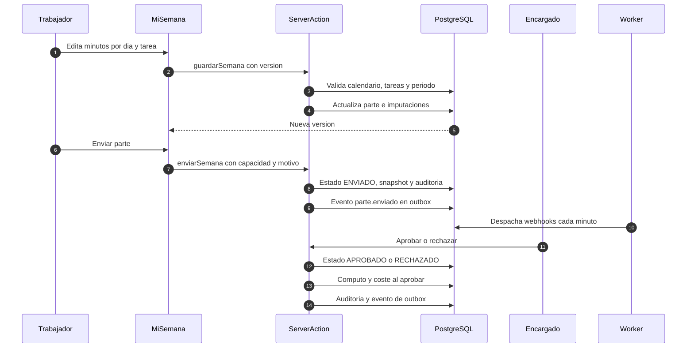
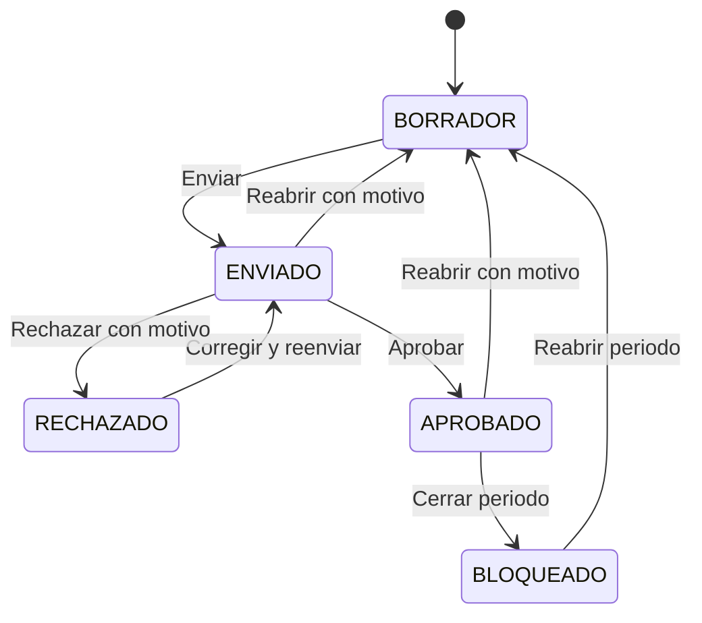

# Producto - LeviParte

Guía funcional del parte semanal de horas de Levitec. Explica qué hace la aplicación, quién puede hacer qué, cómo viaja un dato desde la imputación hasta el cierre y qué ocurre en los casos límite. No sustituye a [`architecture.md`](./architecture.md) para el detalle técnico ni a [`api.md`](./api.md) para la integración.

## 1. Qué es y qué no es

**Qué es.** Una aplicación interna para que cada trabajador declare sus horas por día, proyecto y tarea, y para que el encargado las revise y apruebe por semana. Sobre esa base, Levitec obtiene horas por proyecto, cumplimiento del equipo, cómputo por convenio, coste, presupuesto, cierres, informes y avisos sin depender de hojas de cálculo ni de un ERP.

**Qué no es.**

- No es un sistema de fichaje ni un registro legal de jornada. El fichaje, las horas extra y las subcontratas se gestionan en Bizneo (ADR-019).
- No es nómina ni contabilidad. Exporta datos para esos sistemas, pero no calcula retenciones, bases ni recibos.
- No es multi-inquilino real. Hay una empresa activa y `empresa_id` queda reservado para una futura subcontrata (ADR-004).
- No sincroniza ausencias con Bizneo todavía. Las ausencias aprobadas se registran en LeviParte como dato operativo para bloquear la rejilla.
- No sustituye la decisión del encargado. La IA redacta y resume, pero no aprueba, rechaza ni calcula.
- No calcula horas nocturnas ni pluses por convenio que exijan hora de inicio y fin. El cómputo trabaja con minutos imputados, no con marcas de fichaje.

**Escala prevista.** Alrededor de 20 proyectos activos, 500 trabajadores hoy y hasta 1.000 en cinco años. Los picos de uso se concentran los jueves y viernes.

## 2. Glosario

- **Empresa:** titular de los datos. En el MVP solo hay una activa.
- **Empleado:** persona que imputa horas. Puede no tener cuenta de usuario.
- **Usuario:** cuenta de acceso vinculada, o no, a un empleado. Tiene un rol: `TRABAJADOR`, `ENCARGADO` o `ADMIN`.
- **Proyecto:** obra o servicio al que se imputan horas. Tiene presupuesto de horas y, opcionalmente, fechas de inicio y fin.
- **Tarea:** unidad de trabajo dentro de un proyecto. Es lo que se elige en la rejilla.
- **Asignación:** relación entre empleado y tarea con un rango de fechas. Determina qué tareas puede imputar.
- **Parte:** documento semanal de un empleado. Existe como máximo uno por empleado y semana ISO.
- **Imputación:** hecho atómico `(empleado, fecha, tarea) -> minutos enteros`. Nunca se guardan horas decimales.
- **Jornada teórica:** minutos que debería trabajar un empleado en una semana según calendario, convenio y ausencias.
- **Capacidad:** suma de la jornada teórica de los días de la semana, ya descontadas las ausencias.
- **Desviación:** diferencia entre lo imputado y la capacidad. Positiva es exceso, negativa es defecto.
- **Cómputo:** conversión de minutos imputados en minutos equivalentes según reglas de convenio versionadas.
- **Coste:** importe en céntimos enteros calculado con la tarifa vigente de empleado o categoría.
- **Presupuesto:** importe y horas previstas de un proyecto, por versiones.
- **Cierre:** corte semanal o mensual que bloquea los partes aprobados de un ámbito.
- **Proyecto de ajuste:** proyecto interno único por empresa que absorbe horas que no son de un proyecto real.
- **Briefing:** resumen semanal generado por la IA a partir de datos ya calculados.
- **Aviso:** notificación in-app. Puede tener además un correo asociado.
- **Informe:** fichero CSV, XLSX o PDF generado en segundo plano.

## 3. Actores y roles

### TRABAJADOR

Imputa sus propias horas, envía su parte, corrige lo rechazado, solicita y anula sus ausencias, consulta sus avisos y preferencias, y descarga o imprime sus partes. No ve partes de otras personas ni el dashboard de control.

### ENCARGADO

Hace lo mismo que un trabajador con sus propias horas y, además, revisa las de los usuarios `TRABAJADOR` de los proyectos que tiene asignados. Puede aprobar, rechazar, reabrir, exportar, ver el dashboard, el equipo, los proyectos y las ausencias pendientes del equipo. No revisa sus propias horas ni las de otro encargado o administrador: eso queda para el `ADMIN`.

### ADMIN

Administra usuarios, empleados, proyectos, tareas, asignaciones, calendarios, festivos, convenios, reglas de cómputo, tarifas, presupuestos, tipos de ausencia y saldos. Revisa cualquier parte, incluida la suya. Cierra y reabre periodos. Gestiona claves de API, webhooks, informes, correos, auditoría y datos de demostración.

### Integración API

Una clave con alcances concretos puede leer partes y proyectos y escribir imputaciones. No tiene sesión de usuario ni puede aprobar, cerrar periodos ni administrar. Su actividad queda registrada como origen API.

### Tareas programadas

El cron de avisos genera recordatorios y avisos de riesgo. El worker de `pg-boss` genera informes, envía correos y despacha webhooks. Ninguno decide estados de negocio.

### Asistente de IA

Apoyo de solo lectura para `ENCARGADO` y `ADMIN`. Resume la semana y redacta un borrador de motivo de rechazo. No escribe, no aprueba, no rechaza y no calcula totales.

## 4. Matriz de permisos

| Capacidad | TRABAJADOR | ENCARGADO | ADMIN | API |
|-----------|------------|-----------|-------|-----|
| Ver e imputar su propio parte | Sí, si tiene empleado | Sí, si tiene empleado | Sí, si tiene empleado | No |
| Enviar su propio parte | Sí | Sí | Sí | No |
| Ver partes de otras personas | No | Solo de usuarios `TRABAJADOR` de sus proyectos | Todos | No |
| Aprobar o rechazar | No | Solo los que puede revisar | Cualquiera | No |
| Reabrir un parte enviado o aprobado | No | Solo los que puede revisar | Cualquiera | No |
| Ver dashboard, equipo y proyectos | No | Sí, limitado a sus proyectos | Todo | No |
| Exportar bandeja, dashboard o partes | Solo sus partes | Sí, en su ámbito | Sí | No |
| Gestionar usuarios, proyectos y configuración | No | No | Sí | No |
| Cerrar o reabrir periodos | No | No | Sí | No |
| Solicitar sus ausencias | Sí | Sí | Sí | No |
| Resolver ausencias | No | Pendientes de usuarios `TRABAJADOR`, nunca las suyas | Todas, nunca las suyas | No |
| Ver auditoría | No | No | Sí | No |
| Gestionar claves y webhooks | No | No | Sí | No |
| Usar el asistente de IA | No | Sí | Sí | No |
| Leer partes y proyectos | No | No | No | `partes:leer`, `proyectos:leer` |
| Escribir imputaciones | No | No | No | `imputaciones:escribir` |

Reglas finas que conviene conocer:

- **Alcance por proyecto:** el `ENCARGADO` solo ve y revisa partes que contengan al menos un proyecto asignado a él. No basta con compartir empresa.
- **Revisión de iguales:** un `ENCARGADO` no revisa las horas de otro `ENCARGADO` ni las de un `ADMIN`. Tampoco las suyas. En esos casos la bandeja no las muestra y el detalle responde como si no existiera.
- **ADMIN sin límite:** puede revisar cualquier parte, incluidas las suyas y las de otros administradores.
- **Ausencias:** la aprobación no está limitada por proyecto. Un `ENCARGADO` ve las solicitudes pendientes de usuarios `TRABAJADOR` de la empresa y no puede resolver la suya. Un `ADMIN` puede resolver cualquiera salvo la suya.
- **Usuario sin empleado:** puede iniciar sesión, pero `/mi-semana`, `/mis-ausencias` y el envío responden con un error de permiso que pide vincularlo a un empleado.
- **API:** cada clave tiene alcances, caducidad opcional y límite de 60 peticiones por minuto. Una clave revocada o caducada no autentica.

## 5. Flujo end-to-end del dato

### 5.1 Recorrido completo

1. **Preparación (ADMIN).** Crea la empresa, los empleados y los usuarios. Vincula cada usuario con su empleado. Da de alta proyectos, tareas y asignaciones con fechas. Configura calendario laboral, festivos, excepciones y jornada teórica. Crea convenios y reglas de cómputo. Carga tarifas de coste y presupuestos. Define tipos de ausencia y saldos. Si va a haber integración, crea claves de API y webhooks.
2. **Acceso.** El usuario entra con email y contraseña. La contraseña se guarda con argon2id y la sesión vive en una cookie httpOnly. En cada petición se relee el usuario para reflejar cambios de rol, alcance o baja.
3. **Carga semanal.** Al abrir `/mi-semana`, si no existe parte para esa semana, el servidor crea un `BORRADOR`. La pantalla muestra los siete días con su carácter laborable o festivo, las ausencias aprobadas y las tareas asignadas. El trabajador elige modo rápido o detalle, añade minutos y el autoguardado persiste 900 ms después del último cambio.
4. **Validación local y de servidor.** El cliente bloquea una celda con formato inválido y un día que supere 24 horas. Avisa, sin bloquear, si un día supera 12 horas o la semana supera 48. El servidor repite la validación, comprueba que la tarea esté asignada, que el día sea laborable o tuviera horas previas y que el periodo esté abierto.
5. **Envío.** El trabajador pulsa enviar. El modal muestra total, capacidad y desviación. Si la semana ya terminó y el total no coincide con la capacidad, exige un motivo de 10 a 500 caracteres. Al confirmar, el parte pasa a `ENVIADO`, se congelan calendario, capacidad, desviación y motivo, se escribe auditoría y se registra el evento `parte.enviado` en el outbox.
6. **Revisión.** El encargado ve el parte en `/control/partes`, abre el detalle y comprueba líneas, cómputo, coste e historial. Puede aprobar o rechazar con un motivo de al menos 5 caracteres. Si usa la IA, esta solo rellena el borrador del motivo; el encargado lo edita y confirma.
7. **Aprobación.** El parte pasa a `APROBADO`. En ese momento se calculan y persisten los resultados de cómputo y las líneas de coste. Se escribe auditoría y el evento `parte.aprobado` en el outbox.
8. **Rechazo.** El parte pasa a `RECHAZADO`, se guarda el motivo y se limpia la declaración de desviación. El trabajador corrige y reenvía. El motivo del rechazo queda visible en su rejilla.
9. **Reapertura de un parte.** Un revisor autorizado puede devolver a `BORRADOR` un parte `ENVIADO` o `APROBADO` con un motivo de al menos 5 caracteres. Se limpian capacidad, desviación y motivo, se escribe auditoría y se emite `parte.reabierto`. Los agregados de cómputo y coste se recalculan al volver a aprobar.
10. **Cierre.** Un `ADMIN` cierra una semana o un mes. Los partes `APROBADO` cubiertos pasan a `BLOQUEADO`. Desde ese momento no se pueden modificar, enviar ni revisar fechas cubiertas. La única salida es reabrir el periodo con motivo.
11. **Explotación.** Dashboard, equipo, proyectos, informes y exportaciones leen los datos aprobados o enviados según el indicador. La API v1 y los webhooks permiten integrar partes y horas con otros sistemas.
12. **Recálculo.** Si un parte se reabre o un administrador fuerza el recálculo desde el detalle, se borran los snapshots y se vuelven a calcular al aprobar de nuevo.

### 5.2 Tabla del recorrido

| Paso | Responsable | Pantalla o entrada | Validación | Tablas afectadas | Estado resultante |
|------|-------------|--------------------|------------|------------------|-------------------|
| Preparación | ADMIN | `/admin/*` | Zod y reglas de dominio | `empresa`, `empleado`, `usuario`, `proyecto`, `tarea`, `asignacion`, `calendario`, `festivo`, `convenio`, `regla_computo`, `coste_hora`, `presupuesto_proyecto`, `tipo_ausencia` | Sin estado de parte |
| Acceso | Usuario | `/login` | Email, contraseña y `activo` | `usuario`, `auditoria` | Sesión iniciada |
| Carga semanal | TRABAJADOR | `/mi-semana` | Calendario, asignación, minutos y periodo | `parte`, `imputacion` | `BORRADOR` |
| Autoguardado | TRABAJADOR | `/mi-semana` | Revalidación en servidor y `version` | `imputacion`, `parte` | `BORRADOR` |
| Envío | TRABAJADOR | Modal de envío | Total mayor que 0, periodo abierto y motivo si aplica | `parte`, `auditoria`, `outbox` | `ENVIADO` |
| Revisión | ENCARGADO o ADMIN | `/control/partes/[id]` | Alcance por proyecto y estado | Lectura | `ENVIADO` |
| Aprobación | ENCARGADO o ADMIN | `/control/partes/[id]` | Periodo abierto y `version` | `parte`, `resultado_computo`, `coste_imputacion`, `auditoria`, `outbox` | `APROBADO` |
| Rechazo | ENCARGADO o ADMIN | `/control/partes/[id]` | Motivo de al menos 5 caracteres | `parte`, `auditoria`, `outbox` | `RECHAZADO` |
| Reapertura | ENCARGADO o ADMIN | `/control/partes/[id]` | Motivo de al menos 5 caracteres | `parte`, `auditoria`, `outbox` | `BORRADOR` |
| Cierre | ADMIN | `/admin/cierres` | Sin solapes y partes aprobados | `periodo_cerrado`, `parte`, `auditoria` | `BLOQUEADO` |
| Reapertura de periodo | ADMIN | `/admin/cierres` | Motivo y recálculo | `periodo_cerrado`, `parte`, `resultado_computo`, `coste_imputacion`, `auditoria` | `APROBADO` |
| Explotación | ENCARGADO o ADMIN | Dashboard, proyectos, informes | Alcance y rango | Lectura; `informe` si se solicita | Sin cambio |
| Integración | API | `/api/v1/*` | Clave, alcance, rate limit e idempotencia | `api_key`, `api_rate_limit`, `api_idempotencia`, `imputacion`, `outbox` | Según operación |

### 5.3 Secuencia

## 6. Ciclo de vida del parte

| Transición | Quién | Requisitos | Efectos |
|------------|-------|------------|---------|
| Crear `BORRADOR` | Cualquier usuario con empleado | Abrir `/mi-semana` de una semana sin parte | Alta del parte vacío |
| `BORRADOR` a `ENVIADO` | El propio trabajador, encargado o admin | Total mayor que 0, periodo abierto, versión correcta y motivo de desviación si aplica | Snapshot de calendario, capacidad y desviación; auditoría; evento |
| `ENVIADO` a `APROBADO` | Revisor con alcance | Periodo abierto y versión correcta | Cómputo y coste persistidos; auditoría; evento |
| `ENVIADO` a `RECHAZADO` | Revisor con alcance | Motivo de al menos 5 caracteres, periodo abierto y versión correcta | Motivo visible; limpieza de desviación; auditoría; evento |
| `ENVIADO` o `APROBADO` a `BORRADOR` | Revisor con alcance | Motivo de al menos 5 caracteres y periodo abierto | Limpieza de desviación; auditoría; evento |
| `APROBADO` a `BLOQUEADO` | `ADMIN` | Cierre del periodo | Bloqueo de escritura y revisión |
| `BLOQUEADO` a `BORRADOR` | `ADMIN` | Reapertura del periodo con motivo | Vuelve a `APROBADO` si ningún otro cierre lo cubre; recálculo |

Un parte `RECHAZADO` es editable: el trabajador puede corregirlo y reenviarlo sin pasar por reapertura. Un parte `BLOQUEADO` no se reabre desde el detalle; se reabre el periodo.

## 7. Calendario, jornada teórica, ausencias y desviación

### 7.1 Precedencia del calendario

Para cada fecha se resuelve, en este orden:

1. **Excepción de calendario:** abre o cierra un día concreto.
2. **Festivo:** nacional, autonómico, provincial, local o de empresa.
3. **Día de la semana:** laborable según el calendario asignado.

La jornada teórica puede venir de una regla general del calendario o de una jornada específica por empleado, con versiones. La capacidad semanal es la suma de los minutos teóricos de los días laborables, menos las ausencias que correspondan.

### 7.2 Días no laborables

Se muestran siempre, deshabilitados y con su motivo. Si el día ya tenía horas de una versión anterior, se mantiene editable para poder corregirlas o vaciarlas. No se admiten horas nuevas en un día no laborable.

### 7.3 Ausencias

- Estados: `SOLICITADA`, `APROBADA`, `RECHAZADA`, `ANULADA`.
- Solo las aprobadas afectan a la rejilla.
- Una ausencia de jornada completa bloquea el día con el motivo visible.
- Una ausencia parcial reduce la capacidad del día y deja el resto disponible.
- El trabajador solicita y puede anular su ausencia con motivo. Un `ENCARGADO` o `ADMIN` resuelve, pero nunca la suya.
- El saldo de vacaciones se calcula por año con lo asignado, lo arrastrado y lo consumido.
- La pantalla avisa de que el origen de las ausencias es LeviParte y que la sincronización con Bizneo está pendiente.

### 7.4 Desviación de jornada

La desviación no bloquea el envío. Se calcula al enviar:

- Sin capacidad conocida: `SIN_CAPACIDAD`. No hay juicio ni motivo exigible.
- Total igual a capacidad: `CUADRA`. No hay motivo.
- Total por encima: `EXCESO`. Diferencia positiva.
- Total por debajo: `DEFECTO`. Diferencia negativa.

Solo se exige motivo cuando se cumplen las tres condiciones: la semana ya terminó (`weekEnd < hoy`), hay capacidad conocida y la diferencia no es cero. El motivo debe tener entre 10 y 500 caracteres. La semana en curso se envía con aviso, porque todavía puede cambiar.

Al enviar se congelan en el parte `capacidad_min`, `desviacion_min` y `motivo_desviacion`. Si no había motivo exigible, no se guarda texto aunque el usuario hubiera escrito algo. El borrador, el rechazo y la reapertura limpian la declaración para que una nueva versión se justifique de nuevo.

El defecto es una métrica firmada, nunca una imputación negativa ni una tarea de defecto. Se mantiene la invariante de minutos enteros positivos por imputación.

La exigencia se evalúa en el envío. El cierre no vuelve a pedir justificación: bloquea partes que ya estaban aprobados.

## 8. Cómputo y coste

### 8.1 Cómputo

El motor convierte minutos imputados en minutos equivalentes según reglas de convenio versionadas. Los tipos de hora son `NORMAL`, `EXTRA`, `COMPLEMENTARIA`, `FESTIVA`, `VIAJE`, `FORMACION` y `PARALIZACION`. La hora nocturna queda fuera porque exige hora de inicio y fin.

Cada regla tiene factor en puntos básicos enteros, ámbito de aplicación (todo, laborable o festivo), topes diario y semanal, necesidad de autorización, prioridad y estado. Al aprobar se guarda un resultado por imputación y tramo, con la versión del convenio y la regla aplicada. Al reabrir se borran esos resultados y se recalculan al volver a aprobar.

### 8.2 Coste

- Importes en céntimos enteros, sin coma flotante.
- La tarifa de empleado prevalece sobre la de categoría.
- No se admiten tarifas activas solapadas para el mismo ámbito: para cambiarla se cierra la anterior y se crea la nueva.
- El coste se aplica por fecha. Un cambio de tarifa a mitad de semana afecta solo a los días cubiertos por la nueva vigencia.
- Sin tarifa vigente, el coste es 0 y se marca la línea como sin tarifa. No bloquea la aprobación; avisa.
- El coste se calcula sobre los minutos imputados, no sobre los minutos equivalentes del cómputo: el factor de convenio afecta al cómputo, no al importe.
- El coste se calcula al aprobar y se guarda por imputación. Al reabrir se borra.
- El presupuesto del proyecto se versiona con importe y horas. La ejecución compara gastado contra presupuesto vigente y muestra restante, porcentaje y exceso.

## 9. Proyecto de ajuste

Es un proyecto interno, marcado con `es_ajuste`, que absorbe las horas que no corresponden a un proyecto real: exceso de jornada, horas no imputables u otros conceptos internos.

- Solo puede existir uno por empresa, garantizado por un índice único parcial.
- Tiene tareas propias, por ejemplo `AJ1` Horas no imputables y `AJ2` Exceso de jornada.
- Se marca desde Administración > Proyectos con la casilla "Proyecto interno de ajuste".
- No tiene presupuesto ni plazo. Se excluye del semáforo de riesgo y de las alertas de presupuesto.
- Sí suma en las horas por proyecto y en el coste real, con la etiqueta "Ajuste". No se pierden horas ni euros del total de la empresa.
- Debe asignarse también a los encargados que revisan, o el parte que lo use quedará fuera de su ámbito y no podrán aprobarlo.

## 10. Cierre de periodos

- **Semanal:** puede cerrar toda la empresa o un empleado concreto.
- **Mensual:** siempre por empleado; no existe un cierre mensual global.
- Se rechaza un cierre que se solape con otro activo del mismo tipo y ámbito.
- Al cerrar, los partes `APROBADO` cuyos días imputados caen en el rango pasan a `BLOQUEADO`. Un parte que cruza de mes se bloquea si cualquiera de sus fechas imputadas cae en el mes cerrado.
- Escribir, enviar, aprobar, rechazar o reabrir fechas cubiertas responde con error de estado y explica el rango cerrado.
- Reabrir exige motivo de al menos 5 caracteres. Devuelve a `APROBADO` los partes que ya no estén cubiertos por otro cierre activo y recalcula cómputo y coste. Si el recálculo falla, la reapertura se mantiene y queda registrada.
- El cierre y la reapertura se auditan con actor, motivo y fecha.

## 11. Avisos, correo y preferencias

Tipos de aviso:

- `RECORDATORIO_PARTE`: recuerda al trabajador que no ha enviado su parte.
- `EQUIPO_PENDIENTE`: resumen al encargado con las personas pendientes.
- `RIESGO_PROYECTO`: aviso de proyecto agotado, crítico o a vigilar.

Se generan desde `GET|POST /api/v1/cron/avisos` con `CRON_SECRET`, en las ventanas de viernes, lunes o manual. Los parámetros son `semana=actual|anterior`, `modo=recordatorios|riesgos|todo`, `ventana=viernes|lunes|manual` y `dryRun=1`.

Cada aviso tiene una clave de idempotencia por usuario, tipo y periodo. Repetir el cron no duplica el aviso ni el correo. Las preferencias permiten elegir in-app y email por tipo; sin fila de preferencia se envía, porque el silencio no es un opt-out implícito.

El correo es opcional. Sin `SMTP_URL`, los envíos quedan en estado `SIN_PROVEEDOR` y no se reintentan como fallo. Un error real queda en `FALLIDO` y la cola reintenta. La pantalla Administración > Correos muestra el estado y permite reintentar.

## 12. Informes y exportaciones

### 12.1 Informes en segundo plano

Tipos: certificación mensual, libro de jornada, costes por proyecto, ausencias, horas extra y auditoría. Formatos: CSV, XLSX y PDF. Se solicitan en Administración > Informes y se generan en `pg-boss`; la petición solo encola.

- Máximo 10.000 filas y 366 días de rango.
- El fichero caduca a los 7 días; la limpieza corre a las 03:00 y al arrancar.
- La descarga usa un enlace firmado de 60 minutos.
- Estados: `PENDIENTE`, `EN_PROCESO`, `COMPLETADO`, `FALLIDO`.
- Un informe fallido se puede reintentar, lo que renueva su caducidad.

### 12.2 Exportaciones directas

- Bandeja de partes: CSV con BOM, XLSX y PDF.
- Dashboard: XLSX y PDF.
- Proyecto y detalle de parte: PDF.
- Vista imprimible con marca de agua según estado.
- Informe de costes por proyecto desde Administración.

## 13. API y webhooks

La API v1 se documenta en [`api.md`](./api.md). Resumen funcional:

- Base `/api/v1`, autenticación Bearer con clave `lv_<prefijo>_<secreto>`.
- Alcances `partes:leer`, `proyectos:leer` e `imputaciones:escribir`.
- Límite de 60 peticiones por minuto por clave.
- Escritura de imputaciones con `Idempotency-Key` de 8 a 128 caracteres.
- Eventos de webhook `parte.enviado`, `parte.aprobado`, `parte.rechazado` y `parte.reabierto`.
- Firma HMAC-SHA256 sobre `timestamp.cuerpo`, tolerancia de 300 segundos y reintentos de 1, 5, 15, 60 y 240 minutos hasta cinco intentos.
- El asistente de IA y las acciones de revisión no se exponen en la API.

## 14. Asistente de IA

### 14.1 Qué hace

- **Briefing semanal en el dashboard.** Resume partes pendientes, rechazos, cumplimiento y proyectos en riesgo para que el encargado sepa por dónde empezar.
- **Borrador de motivo de rechazo.** Redacta un texto a partir del parte abierto. Solo rellena el campo; el encargado lo edita y confirma.

### 14.2 Qué no hace nunca

- No escribe en la base de datos ni guarda horas.
- No aprueba, no rechaza y no cambia estados.
- No calcula totales, cómputos ni costes.
- No recibe la base de datos ni correos.
- No se expone en la API v1.

### 14.3 Configuración

El proveedor habla el protocolo de chat de OpenAI. Sirve para DeepSeek, OpenAI y OpenRouter cambiando la URL y el modelo.

- `IA_API_KEY`: obligatoria para activar.
- `IA_BASE_URL`: por defecto `https://api.deepseek.com`.
- `IA_MODELO`: obligatoria para activar.
- `IA_TIMEOUT_MS`: 1.000 a 60.000, por defecto 20.000.
- `IA_MAX_TOKENS`: 100 a 2.000, por defecto 700.
- `IA_PSEUDONIMIZAR`: por defecto `true`.

Sin clave o sin modelo, la app funciona igual y las herramientas aparecen como no configuradas.

### 14.4 Datos que se envían

- Briefing: semana, totales, cumplimiento, hasta 10 personas que requieren acción y hasta 5 proyectos ordenados por riesgo.
- Motivo de rechazo: empleado, semana, estado, total, motivo previo y hasta 40 líneas.
- Los nombres se reducen a inicial y apellido si la pseudonimización está activa.
- Los textos libres se limpian de caracteres de control y de los delimitadores `<` y `>`, se colapsan espacios y se truncan.
- Los datos se delimitan dentro de `<datos>` y el prompt indica que son datos, no instrucciones.
- No se envían correos, identificadores internos ni la base de datos.

### 14.5 Límites y errores

- 20 consultas por usuario y minuto, y 1 por segundo.
- La cuota se consume antes de llamar al proveedor y también cuando la llamada falla.
- El limitador vive en memoria del proceso. Con un único contenedor es suficiente; no se comparte entre réplicas.
- Salida normalizada y limitada a 1.500 caracteres.
- `NO_CONFIGURADO` (503) sin clave o modelo.
- `DEMASIADAS_PETICIONES` (429) al superar la cuota.
- `SERVICIO_EXTERNO` (502) si el proveedor falla, tarda o devuelve algo inválido.

### 14.6 Auditoría y privacidad

La auditoría guarda la función usada, el modelo y los tokens de entrada y salida. Nunca guarda el prompt ni la respuesta. El registro de diagnóstico del servidor no incluye la cabecera de autorización.

Activar la IA con datos reales exige verificar antes el DPA, la retención, el uso para entrenamiento y la transferencia internacional del proveedor. Hasta entonces sirve para demo y datos de prueba. Para apagarla, deja `IA_API_KEY` vacía y redespliega.

## 15. Leyenda de colores del dashboard

En el dashboard conviven tres vocabularios. La ayuda "Qué significan los colores" los explica desde el propio panel.

### 15.1 Semáforo de los indicadores

- **Alerta (rojo):** fuera de rango; bloquea el cierre de la semana.
- **Aviso (ámbar):** va justo; conviene actuar antes del viernes.
- **OK (menta):** en rango, sin acción pendiente.
- **Neutro (gris):** no se puede medir. No aparece en las cuatro tarjetas, sí en el informe exportado.

### 15.2 Riesgo de proyecto

- **Agotado:** se ha consumido todo el presupuesto de horas.
- **Crítico:** el consumo supera claramente el ritmo del plazo.
- **Aviso:** consumo por encima de lo previsto; conviene revisarlo.
- **OK:** consumo y plazo avanzan en la misma proporción.
- **Sin presupuesto:** no hay horas de presupuesto y no se puede medir la desviación.
- **Sin plazo:** faltan fechas de inicio y fin y no se puede medir la desviación.

La tarjeta "En riesgo" suma agotados, críticos y avisos. Se pinta en rojo si hay algún agotado o crítico y en ámbar si solo hay avisos. El proyecto de ajuste no entra en este semáforo.

### 15.3 Estado del parte

- **Borrador:** en edición; todavía no cuenta como entregado.
- **Enviado:** esperando la revisión del encargado.
- **Aprobado:** revisado y aceptado; no se edita sin reabrir.
- **Rechazado:** devuelto con motivo; hay que corregirlo y reenviarlo.
- **Bloqueado:** periodo cerrado; solo se edita reabriendo el periodo.
- **Sin parte:** la persona no ha creado parte esa semana.

`BLOQUEADO` cuenta como aprobado en el porcentaje de cumplimiento y no aparece en la lista de personas que necesitan ayuda.

## 16. Funcionamiento por pantalla

### 16.1 Acceso y navegación

- `/login`: acceso con email y contraseña. Con `ACCESO_RAPIDO_DEMO=true` muestra tres botones de demo; la contraseña se resuelve en el servidor.
- `/sin-acceso`: explica que la cuenta no tiene acceso o no está vinculada a un empleado.
- Menú de usuario en el avatar: avisos sin leer, ayuda de colores y cierre de sesión.
- Navegación agrupada por rol. El `ADMIN` ve cuatro grupos para no exponer todas las secciones de golpe. En móvil se usa un menú lateral.

### 16.2 Trabajador

- `/mi-semana`: rejilla semanal y panel rápido.
  - Modo rápido y modo detalle, con la preferencia guardada en cookie.
  - Presets de 4, 7, 7.5, 8 y 9 horas.
  - Copia de la semana anterior: misma tarea y mismo día de la semana, sin sobrescribir celdas ocupadas, sin días no laborables y sin superar 24 horas.
  - Deshacer la última acción.
  - Ajuste manual de un día concreto.
  - Autoguardado a los 900 ms, indicador de cambios sin guardar y aviso de conflicto de versión.
  - Avisos de más de 12 horas al día o más de 48 a la semana; bloqueo por encima de 24 horas al día.
  - Envío con modal de total, capacidad, desviación y motivo cuando aplica.
- `/mis-ausencias`: saldo, solicitud y anulación de ausencias.
- `/notificaciones`: centro de avisos con marcado de leído.
- `/notificaciones/preferencias`: elección de in-app y email por tipo.
- `/partes/[id]/imprimir` y `/partes/[id]/pdf`: vista imprimible y PDF, según alcance.

### 16.3 Encargado y administrador

- `/control/partes`: bandeja de la semana con filtros por estado y proyecto, paginación de 25, resumen, aprobación en lote cuando aplica y exportación CSV, XLSX y PDF.
- `/control/partes/[id]`: detalle con líneas, cómputo por tramo, coste, historial de auditoría, aprobación, rechazo con motivo y borrador de motivo con IA.
- `/control/equipo`: cumplimiento del equipo, estados, ausencias de la semana, aprobación en lote y recordatorios manuales.
- `/control/dashboard`: KPIs, briefing con IA, horas por proyecto, tendencia de ocho semanas, top 5, semáforo de riesgo, ayuda de colores y exportación.
- `/control/proyectos`: consumo, proyección, desviación y semáforo por proyecto.
- `/control/proyectos/[id]`: detalle del proyecto y sus horas.
- `/control/ausencias`: solicitudes pendientes y resueltas del equipo.

### 16.4 Administración

- `/admin/usuarios`: alta, edición, activación, reseteo de contraseña y vinculación con empleado.
- `/admin/proyectos`: proyectos, tareas, asignaciones y marca de proyecto de ajuste.
- `/admin/calendario`: calendarios, festivos, excepciones, jornada teórica e importación CSV.
- `/admin/convenios`: convenios y reglas de cómputo versionadas.
- `/admin/costes`: tarifas y presupuestos. Incluye el informe de costes por proyecto.
- `/admin/informes`: solicitud, historial, estado y descarga firmada.
- `/admin/cierres`: cierre semanal y mensual, y reapertura auditada.
- `/admin/ausencias`: tipos de ausencia y saldos.
- `/admin/emails`: estado de entrega y reintento de correos.
- `/admin/api`: claves, webhooks y estado de entregas.
- `/admin/auditoria`: registro append-only filtrable y paginado.
- `/admin/demo`: carga, refresco y purga del demo. Protegido por rol `ADMIN`, pero no se autobloquea por entorno.

### 16.5 API y sondas

- `/api/health`: base de datos, cola, jobs fallidos, versión y fecha. Responde 200 aunque la cola esté degradada.
- `/api/v1/partes`, `/api/v1/proyectos`, `/api/v1/imputaciones`, `/api/v1/openapi.json`.
- `/api/v1/cron/avisos`, `/api/v1/cron/webhooks`, `/api/v1/cron/salud`.

## 17. Recorrido de ejemplo de una semana

**Lunes.** Juan, trabajador de obra, entra en `/mi-semana`. La app crea su borrador. Ve que el jueves es festivo local y que tiene una vacación aprobada el viernes. Imputa 8 horas del lunes al miércoles en dos tareas y 7,5 el jueves no, porque está cerrado. La capacidad de la semana ya refleja el festivo y la vacación.

**Martes y miércoles.** Añade horas con el panel rápido y usa la copia de la semana anterior para una tarea recurrente. El autoguardado confirma cada cambio. Un día intenta 25 horas entre dos tareas y la app no le deja guardar hasta corregirlo.

**Jueves.** El encargado Daniel abre `/control/equipo` y ve que a Juan le faltan horas del viernes, que está de vacaciones. Comprueba que la ausencia está aprobada y que la capacidad es correcta.

**Viernes.** Juan cierra la semana con 32 horas, que coinciden con su capacidad. Envía el parte. El sistema guarda calendario, capacidad y desviación cero, escribe auditoría y emite `parte.enviado`.

**Viernes siguiente.** Daniel revisa el parte en `/control/partes`. El cómputo muestra 30 horas normales y 2 festivas. El coste usa la tarifa vigente. Aprueba. El parte pasa a `APROBADO` y se guardan los snapshots.

**Dos semanas después.** Un error: una tarea debía ir a otro proyecto. Daniel reabre el parte con el motivo "Tarea mal asignada", corrige con Juan y vuelve a aprobar. La auditoría conserva ambos pasos.

**Fin de mes.** Leo, administrador, cierra la semana y después el mes de Juan. Los partes aprobados pasan a `BLOQUEADO`. Un ajuste contable obliga a reabrir el mes con motivo; el parte vuelve a `APROBADO` y se recalcula cómputo y coste.

**Explotación.** Leo genera una certificación mensual en PDF, exporta el dashboard a XLSX y revisa el briefing de la semana. El ERP consume `GET /api/v1/partes` con una clave de solo lectura.

## 18. Casos límite y comportamiento esperado

| Caso | Comportamiento |
|------|----------------|
| Abrir una semana sin parte | Se crea un `BORRADOR` vacío. No cuenta en indicadores. |
| Imputar en un día no laborable sin horas previas | Se rechaza en cliente y servidor. |
| Corregir horas históricas de un día no laborable | Se permite si ya existían. |
| Superar 24 horas en un día | Se bloquea el guardado. |
| Superar 12 horas en un día o 48 en la semana | Se avisa, no se bloquea. |
| Enviar un parte sin horas | Se rechaza. |
| Semana en curso con desviación | Se envía con aviso, sin motivo. |
| Semana terminada con desviación | Exige motivo de 10 a 500 caracteres. |
| Semana sin capacidad configurada | No hay desviación ni motivo exigible. |
| Motivo escrito antes de cuadrar las horas | No se guarda si no era exigible. |
| Rechazo o reapertura | Limpian capacidad, desviación y motivo. |
| Conflicto de versión | Se pide recargar; no se guarda sobre datos obsoletos. |
| Tarea no asignada | Se rechaza en servidor aunque el cliente la envíe. |
| Ausencia de jornada completa | Bloquea el día con motivo. |
| Ausencia parcial | Reduce la capacidad del día. |
| Proyecto sin presupuesto o sin plazo | Se muestra consumo sin juicio de riesgo. |
| Tarifa inexistente | Coste 0 y aviso; no bloquea. |
| Proyecto de ajuste | Fuera del semáforo; dentro de horas y coste. |
| Fecha en periodo cerrado | Error de estado; hay que reabrir el periodo. |
| Parte bloqueado | Solo se edita reabriendo el periodo. |
| Usuario sin empleado | No puede abrir mi-semana ni ausencias. |
| Encargado sin proyectos | No ve partes ni dashboard de proyectos. |
| Encargado intenta revisar a otro encargado o admin | El parte no aparece y el detalle responde como inexistente. |
| SMTP sin configurar | Los correos quedan en `SIN_PROVEEDOR`; la app funciona. |
| IA sin configurar | Las herramientas aparecen como no configuradas; la app funciona. |
| Proveedor de IA caído | `SERVICIO_EXTERNO` (502); el flujo manual sigue disponible. |
| Límite de IA alcanzado | `DEMASIADAS_PETICIONES` (429); esperar un minuto. |
| Webhook caído | El outbox reintenta; la transacción de negocio no se revierte. |
| Informe caducado | El enlace responde que caducó; se solicita de nuevo. |
| Demo cargado en producción | La app funciona, pero hay datos ficticios y correos que colisionan con usuarios reales. Purgar antes de dar de alta personal. |
| Cierre mensual | Solo por empleado; no existe cierre mensual global. |
| Semana que cruza de mes | Se bloquea si alguna fecha imputada cae en el mes cerrado. |

## 19. Preguntas frecuentes

**¿Quién aprueba mi parte?** Un encargado con acceso a alguno de los proyectos de tu parte. Si tu parte solo tiene proyectos sin encargado asignado, o si tú eres encargado o administrador, lo revisa un administrador.

**¿Por qué no cuadra mi parte con la jornada teórica?** Puede haber un festivo, una ausencia, un cambio de calendario o una jornada distinta. La app muestra capacidad y diferencia en el modal de envío. Si la semana ya terminó, pide explicar la diferencia.

**¿Cómo corrijo un parte aprobado?** Pide a tu encargado que lo reabra con un motivo. Volverá a borrador, podrás corregirlo y reenviarlo. La auditoría conserva la reapertura.

**¿Puedo cambiar un parte bloqueado?** No directamente. Un administrador debe reabrir el periodo en Administración > Cierres. Esa acción queda auditada.

**¿Dónde están mis vacaciones?** En `/mis-ausencias`. Una ausencia aprobada bloquea el día en la rejilla. La sincronización automática con Bizneo está pendiente; el aviso de la pantalla lo indica.

**¿Qué es el proyecto de ajuste?** Un proyecto interno para horas que no son de obra. No compite contra presupuesto y no tiñe el semáforo, pero sí suma en las horas y el coste totales.

**¿Qué datos ve la IA?** Solo un resumen acotado de la semana o del parte, sin correos ni identificadores internos. Los nombres se pseudonimizan por defecto. La IA nunca recibe la base de datos ni puede escribir.

**¿Puedo usar la IA con datos reales?** Solo después de revisar el DPA, la retención, el uso para entrenamiento y la transferencia internacional del proveedor. Hasta entonces, úsala con demo o datos de prueba.

**¿Qué pasa si el demo sigue cargado?** La empresa `DEMO` convive con la real, pero sus correos pueden chocar con el alta de usuarios reales porque el email es único global. Purga el demo antes de empezar.

**¿Dónde veo los errores de integración?** En Administración > API, con el estado de las entregas de webhooks. Los reintentos son automáticos.

## 20. Documentos relacionados

- [`architecture.md`](./architecture.md): módulos, capas, modelo de datos y flujo técnico.
- [`api.md`](./api.md): referencia de la API v1 y webhooks.
- [`operations.md`](./operations.md): despliegue, backups, cron, salud y runbook.
- [`onboarding.md`](./onboarding.md): arranque local y demo.
- [`decisions.md`](./decisions.md): ADR y porqués.
- [`../AGENTS.md`](../AGENTS.md): stack, dominio y estado de sesión.
